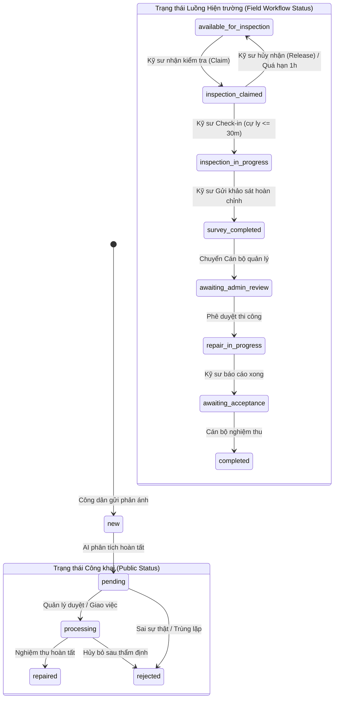

# TÀI LIỆU ĐẶC TẢ VẬN HÀNH & MA TRẬN KIỂM THỬ HỒI QUY TOÀN DIỆN
## (MASTER SYSTEM SPECIFICATION & REGRESSION TEST MATRIX)

> **Mục đích tài liệu**: Tài liệu này đóng vai trò là **"Bản khế ước vận hành cốt lõi" (Ground Truth Operational Contract)** ghi nhận chi tiết bằng mã nguồn (code-level) toàn bộ các chức năng, luồng hoạt động, điều kiện tiên quyết (preconditions), quy tắc hợp lệ (validation rules) và điều kiện hoàn thành (postconditions/state transitions) của cả **3 vai trò người dùng** trên **Cổng Web Quản lý** và **Ứng dụng Di động**. Sau khi thực hiện kiểm tra hoặc tái cấu trúc mã nguồn (refactoring), bạn có thể dựa vào tài liệu này để kiểm chứng rằng hệ thống không bị lỗi, không mất mát chức năng và không làm thay đổi tiến trình vận hành.

---

## PHẦN I: KIẾN TRÚC TỔNG THỂ & QUY CHUẨN DỮ LIỆU CỐT LÕI

### 1. Phân bổ các Thành phần Hệ thống
1. **Dịch vụ Backend API (`services/backend-api`)**:
   - Nền tảng: Python FastAPI, kiến trúc module (`auth`, `gis`, `reports`).
   - Cơ sở dữ liệu: PostgreSQL 16 + PostGIS 3.4 (có cơ chế tương thích trừu tượng SQLite3 khi chạy độc lập).
   - Địa chỉ cục bộ: `http://localhost:5000` (hoặc domain Production qua Cloudflare).
2. **Dịch vụ Trí tuệ Nhân tạo AI (`services/ai-service`)**:
   - Nền tảng: Python FastAPI + YOLOv8 (`ultralytics`).
   - Nhận diện 4 nhóm hư hại mặt đường: Nứt dọc (`D00`), Nứt ngang (`D10`), Nứt da cá sấu (`D20`), Ổ gà (`D40`).
3. **Cổng Web Quản trị (`apps/web-admin`)**:
   - Nền tảng: React 19, Vite, Leaflet/React-Leaflet, Recharts, React Router v7.
   - Địa chỉ cục bộ: `http://localhost:5173`.
4. **Ứng dụng Di động (`apps/mobile-reporter` & `apps/mobile-field-engineer`)**:
   - Nền tảng: React Native 0.81, Expo v57 (`expo-camera`, `expo-location`, `expo-secure-store`).
   - Cổng điều phối thống nhất tại root `App.js` dựa trên vai trò đăng nhập (`resolveAppRole`).
5. **Gói dùng chung (`packages`)**:
   - `packages/shared-constants`: Định nghĩa bảng màu, trạng thái kép, nhãn ngôn ngữ, quy chuẩn hư hỏng.
   - `packages/api-client`: Bộ thư viện Axios cấu hình sẵn Interceptor, tự động xoay vòng Refresh Token.
   - `packages/mobile-shared`: Giao diện đăng nhập dùng chung, cầu nối bản đồ di động, kiểm tra mạng.

---

### 2. Mô hình Máy Trạng thái Kép (Dual Status Machine)
Hệ thống quản lý vòng đời của một điểm hư hỏng đường bộ thông qua **hai lớp trạng thái độc lập**:



#### A. Trạng thái Công khai (Bảng `reports.status`):
- `new` (*Mới ghi nhận*): Báo cáo vừa được đẩy lên hệ thống.
- `pending` (*Chờ xác minh*): Đã có phân tích AI ban đầu, đang chờ cán bộ hoặc kỹ sư kiểm chứng.
- `processing` (*Đang xử lý*): Đã xác minh thực tế, đang trong quá trình khảo sát/thi công.
- `repaired` (*Đã sửa chữa*): Hư hại đã được trám vá, hoàn trả mặt đường an toàn.
- `rejected` (*Từ chối*): Ảnh chụp không phải hư hỏng đường, tin báo giả hoặc không hợp lệ.

#### B. Trạng thái Hiện trường Nội bộ (Bảng `reports.field_status`):
- `available_for_inspection` (*Có thể nhận kiểm tra*): Điểm mở tự do cho mọi kỹ sư hoặc đã được giao đích danh nhưng kỹ sư chưa bấm nhận.
- `inspection_claimed` (*Đã nhận kiểm tra*): Kỹ sư đã bấm giữ quyền (khóa trong 1 giờ `AUTO_RELEASE_WINDOW`).
- `inspection_in_progress` (*Đang kiểm tra hiện trường*): Kỹ sư đã check-in thực địa thành công (cự ly $\le 30$m) hoặc đã lưu bản nháp khảo sát.
- `survey_completed` (*Đã khảo sát xong*): Kỹ sư đã gửi đầy đủ đánh giá hiện trường (loại hư hỏng, mức độ, ưu tiên, ghi chú, ảnh bổ sung).
- `awaiting_admin_review` (*Chờ duyệt khảo sát*): Chờ cán bộ quản lý thẩm định biên bản khảo sát.
- `repair_in_progress` (*Đang sửa chữa*): Đơn vị thi công đang sửa chữa ngoài hiện trường.
- `awaiting_acceptance` (*Chờ nghiệm thu*): Đã thi công xong, chờ nghiệm thu chất lượng.
- `completed` (*Hoàn tất*): Đóng toàn bộ hồ sơ sự cố.

---

### 3. Quy chuẩn Mã Hư hỏng Mặt đường Chuẩn AI YOLOv8
Hệ thống chuẩn hóa 4 lớp hư hỏng mặt đường theo tiêu chuẩn nghiên cứu quốc tế Road Damage Dataset:
1. `D00` (**Nứt dọc** - Longitudinal Crack): Vết nứt chạy dọc theo chiều dài mặt đường/vệt bánh xe.
2. `D10` (**Nứt ngang** - Transverse Crack): Vết nứt cắt ngang vuông góc với tim đường do ứng suất nhiệt độ.
3. `D20` (**Nứt da cá sấu** - Alligator Crack): Mạng lưới nứt đan xen hình mai rùa/da cá sấu, biểu hiện nền đường bị sụt yếu.
4. `D40` (**Ổ gà** - Pothole): Hố trũng sụp lún, bong bật lớp bê tông nhựa, tiềm ẩn nguy cơ tai nạn giao thông nghiêm trọng.

---

## PHẦN II: MA TRẬN PHÂN QUYỀN & RÀO CHẮN BẢO MẬT (SECURITY & RBAC)

### 1. Phân loại 3 Nhóm Vai trò (Roles)
| Nhóm Vai trò | Giá trị trong CSDL (`users.role`) | Môi trường Sử dụng | Quyền hạn Cốt lõi |
| :--- | :--- | :--- | :--- |
| **Role 1: Người dân** | `reporter`, `citizen`, `user` | Mobile App (`mobile-reporter`) | Chụp ảnh gửi phản ánh, xem AI preview, theo dõi lịch sử và bản đồ sự cố cộng đồng. |
| **Role 2: Kỹ sư hiện trường** | `field_engineer`, `engineer`, `engineer_staff` | Mobile App (`mobile-field-engineer`) | Nhận điểm kiểm tra, check-in GPS $\le 30$m, chụp ảnh bổ sung, gửi biên bản khảo sát thực địa. |
| **Role 3: Cán bộ Quản lý / Quản trị viên** | `admin`, `super_admin`, `manager`, `district_officer`, `officer`, `can_bo` | Web Admin (`apps/web-admin`) | Dashboard KPI, Bản đồ GIS, thẩm định AI, đổi trạng thái, điều phối kỹ sư, thống kê báo cáo, quản lý người dùng. |

---

### 2. Các Rào chắn Bảo mật Tuyệt đối (Security Guardrails)

#### Rào chắn 1: Cách ly Nền tảng bằng Header (`X-Auth-Context`)
- **Web Admin**: Header gửi lên bắt buộc là `X-Auth-Context: web-admin`. Nếu tài khoản có vai trò Người dân (`reporter`) hoặc Kỹ sư (`field_engineer`) cố tình đăng nhập -> Backend lập tức trả về **`403 Forbidden`** (*"Tài khoản này là tài khoản Ứng dụng Di động, không được phép đăng nhập vào Web Quản lý"*).
- **Mobile App**: Header gửi lên là `X-Auth-Context: mobile-app`. Nếu tài khoản Quản trị viên (`admin`) cố tình đăng nhập -> Backend chặn mã **`403 Forbidden`** (*"Tài khoản Quản trị viên chỉ được phép đăng nhập trên Cổng Web Quản lý"*).

#### Rào chắn 2: Chặn Leo thang Đặc quyền khi Đăng ký Tự do (Public Registration Guard)
- Khi người dùng gửi yêu cầu tới `POST /api/auth/register`, dù payload có truyền `role: "field_engineer"` hay `role: "admin"`, hàm `AuthRepository.create_user()` tại [repository.py](file:///d:/DATN/Code/road-damage-gis/services/backend-api/app/modules/auth/repository.py#L59) **gán cứng `role = 'reporter'`**.
- Chỉ có Quản trị viên đã đăng nhập trên Web Admin mới có quyền tạo tài khoản Kỹ sư (`field_engineer`) hoặc Cán bộ quận (`district_officer`) qua `POST /api/admin/users`.

#### Rào chắn 3: Phân quyền Không gian Địa lý (Spatial RBAC)
- Được thực thi qua hàm `enforce_spatial_district_access` và `verify_report_spatial_access` tại [dependencies.py](file:///d:/DATN/Code/road-damage-gis/services/backend-api/app/modules/auth/dependencies.py#L125).
- **Cán bộ quản lý Quận** (`district_officer` hoặc tài khoản có trường `managed_district` khác rỗng):
  - Khi tra cứu báo cáo / bản đồ / dashboard: Hệ thống tự động ép điều kiện truy vấn `district = current_user.managed_district`.
  - Nếu cố tình truyền tham số `district` khác quận mình phụ trách: Bị chặn ngay lập tức với mã **`403 Forbidden`** (*"Cán bộ không có quyền truy cập dữ liệu ngoài địa bàn quản lý"*).
  - Khi xem chi tiết hoặc thao tác trên 1 báo cáo cụ thể: Nếu tọa độ/địa chỉ của báo cáo đó nằm ngoài quận quản lý -> Bị chặn mã **`403 Forbidden`**.
- **Quản trị viên Cấp cao** (`super_admin` hoặc tài khoản không giới hạn địa giới): Có quyền xem và điều phối toàn bộ các quận huyện trong thành phố.

#### Rào chắn 4: Thu hồi Phiên tức thì (Instant Session Revocation)
- Khi tài khoản bị Quản trị viên khóa (`is_active = false`), đổi mật khẩu hoặc đăng xuất (`/api/auth/logout`):
  - Trường `users.auth_revoked_at` được cập nhật thời gian hiện tại.
  - Toàn bộ refresh tokens trong bảng `refresh_tokens` bị đánh dấu `revoked_at = NOW()`.
  - Mọi Access Token được cấp trước thời điểm `auth_revoked_at` lập tức bị từ chối với mã **`401 Unauthorized`**, không cần chờ token hết hạn tự nhiên.

---

## PHẦN III: ĐẶC TẢ CHI TIẾT TỪNG VAI TRÒ (CHỨC NĂNG - CÁCH HOẠT ĐỘNG - ĐIỀU KIỆN HOÀN THÀNH)

---

### ROLE 1: NGƯỜI DÂN PHẢN ÁNH (`reporter`)

#### 1.1. Đăng ký & Đăng nhập Người dân
- **Tệp mã nguồn**:
  - Giao diện: [LoginScreen.tsx](file:///d:/DATN/Code/road-damage-gis/apps/mobile-reporter/src/features/auth/LoginScreen.tsx), [RegisterScreen.tsx](file:///d:/DATN/Code/road-damage-gis/apps/mobile-reporter/src/features/auth/RegisterScreen.tsx), [UnifiedLoginScreen.tsx](file:///d:/DATN/Code/road-damage-gis/packages/mobile-shared/src/components/UnifiedLoginScreen.tsx).
  - Backend: `POST /api/auth/register`, `POST /api/auth/login`.
- **Cách hoạt động**:
  - Đăng ký: Nhập Họ tên, Email, Số điện thoại, Mật khẩu. API tạo tài khoản với role `reporter` và trả về cặp JWT Access Token (15 phút) / Refresh Token (7 ngày).
  - Đăng nhập: Nhập Email và Mật khẩu. Hỗ trợ nút điền nhanh "Người dân" trên máy ảo/test mode. Token được lưu an toàn trong `expo-secure-store`.
  - Khởi tạo ứng dụng: Root [App.js](file:///d:/DATN/Code/road-damage-gis/App.js) gọi `bootstrapMobileSession()`, đọc vai trò và tải `MobileReporterApp`.
- **Điều kiện hoàn thành & Hậu kiểm (Postconditions)**:
  - Tài khoản được lưu trong bảng `users` với `role = 'reporter'`, `is_active = true`.
  - Thiết bị lưu trữ thành công phiên đăng nhập, màn hình chuyển sang `HomeScreen`.

---

#### 1.2. Chụp ảnh Hiện trường & Ghi nhận Tọa độ GPS
- **Tệp mã nguồn**:
  - Giao diện: [CameraScreen.tsx](file:///d:/DATN/Code/road-damage-gis/apps/mobile-reporter/src/features/report/CameraScreen.tsx), [GpsStatusCard.tsx](file:///d:/DATN/Code/road-damage-gis/apps/mobile-reporter/src/features/report/components/GpsStatusCard.tsx).
  - Thư viện: `expo-camera`, `expo-location`.
- **Cách hoạt động**:
  - Ứng dụng yêu cầu quyền Camera và Vị trí chính xác (`Accuracy.High`).
  - Giao diện hiển thị khung ngắm chụp ảnh theo chiều dọc kèm chỉ báo trạng thái GPS (Màu xanh: Tốt $\le 10$m, Màu cam: Chấp nhận được $\le 50$m, Màu đỏ: Kém $> 50$m).
  - Khi bấm chụp: Ảnh được chụp ở độ phân giải gốc, đồng thời đọc ngay tọa độ tức thời `(latitude, longitude, gps_accuracy)`.
  - Ngăn chặn tải ảnh từ thư viện (`NoGalleryNotice.tsx`) để chống gian lận vị trí và thời gian.
- **Điều kiện hoàn thành**:
  - Chụp thành công 1 tệp ảnh định dạng JPEG/PNG.
  - Tọa độ GPS phải hợp lệ: $-90 \le \text{lat} \le 90$, $-180 \le \text{lng} \le 180$, khác `(0, 0)`.
  - Sai số định vị `gps_accuracy` $\le 50$m (`settings.max_gps_accuracy_meters`).

---

#### 1.3. Xem trước Nhận diện AI (AI Preview Detection)
- **Tệp mã nguồn**:
  - Giao diện: [CapturedPhotoPreview.tsx](file:///d:/DATN/Code/road-damage-gis/apps/mobile-reporter/src/features/report/components/CapturedPhotoPreview.tsx), [ConfirmReportScreen.tsx](file:///d:/DATN/Code/road-damage-gis/apps/mobile-reporter/src/features/report/ConfirmReportScreen.tsx).
  - Backend: `POST /api/reports/preview-ai`.
- **Cách hoạt động**:
  - Ngay sau khi chụp, ảnh được gửi lên endpoint `preview-ai` để AI YOLOv8 phân tích nhanh.
  - Backend sinh ra một `preview_token` (có hiệu lực trong 10 phút) lưu kết quả phân tích vào bộ nhớ đệm tạm thời.
  - Trên màn hình hiển thị nhãn loại hư hỏng gợi ý (ví dụ: `Ổ gà (D40) - 89%`) và vẽ các khung hộp nhận diện (Bounding Boxes) trực tiếp lên ảnh xem trước.
- **Điều kiện hoàn thành**:
  - Nhận được `preview_token` và danh sách `detections` (hoặc thông báo thân thiện nếu AI chưa nhận diện được).
  - Nếu AI Service bận hoặc lỗi: Trả về trạng thái fallback an toàn, không làm treo ứng dụng, người dân vẫn được tiếp tục gửi phản ánh để cán bộ kiểm tra thủ công.

---

#### 1.4. Xác nhận & Gửi Phản ánh Hư hỏng Mặt đường
- **Tệp mã nguồn**:
  - Giao diện: [ConfirmReportScreen.tsx](file:///d:/DATN/Code/road-damage-gis/apps/mobile-reporter/src/features/report/ConfirmReportScreen.tsx).
  - Backend: `POST /api/reports` (Multipart form-data: `image`, `latitude`, `longitude`, `gps_accuracy`, `location_source`, `note`, `preview_token`).
- **Cách hoạt động**:
  - Người dân kiểm tra lại ảnh xem trước (khung dọc 220-320px kèm ambient blur backdrop), xem tọa độ GPS, nhập ghi chú mô tả (tối đa 500 ký tự).
  - Bấm "Gửi phản ánh":
    - Backend kiểm tra hash của ảnh: nếu trùng với `preview_token` đã cache thì tái sử dụng kết quả, không cần chạy lại mô hình YOLOv8, tối ưu thời gian phản hồi.
    - Lưu file ảnh vào thư mục `uploads/reports/{report_id}.jpg`.
    - Tạo bản ghi trong bảng `reports` với `status = 'pending_verification'` (chuẩn hóa về `pending`), `field_status = 'available_for_inspection'`.
    - Kích hoạt **Background Task**: `geocode_report_background` gọi dịch vụ dịch ngược tọa độ (Reverse Geocoding qua Nominatim/Cache PostGIS) để tự động điền Tên đường (`road_name`), Phường/Xã (`ward`), Quận/Huyện (`district`), Tỉnh/Thành phố (`province`).
- **Điều kiện hoàn thành**:
  - API trả về mã **`201 Created`** cùng đối tượng `ReporterReportResponse`.
  - Cơ sở dữ liệu ghi nhận bản ghi mới có hình học không gian PostGIS `geom = ST_SetSRID(ST_MakePoint(lng, lat), 4326)`.
  - Ứng dụng điều hướng về `HomeScreen` kèm thông báo thành công và xóa sạch bộ nhớ tạm của camera.

---

#### 1.5. Bản đồ Sự cố Cộng đồng (Citizen Map)
- **Tệp mã nguồn**:
  - Giao diện: [MapScreen.tsx](file:///d:/DATN/Code/road-damage-gis/apps/mobile-reporter/src/features/map/MapScreen.tsx), [RoadDamageMapView.native.tsx](file:///d:/DATN/Code/road-damage-gis/packages/mobile-shared/src/map/RoadDamageMapView.native.tsx).
  - Backend: `GET /api/gis/search?exclude_repaired=true`.
- **Cách hoạt động**:
  - Tải dữ liệu các điểm hư hỏng mặt đường dưới dạng GeoJSON FeatureCollection.
  - Áp dụng thuật toán gom cụm khoảng cách màn hình:
    - Các điểm cách nhau $\le 38\text{px}$ tự động gộp thành vòng tròn màu cam hiển thị số lượng ($\ge 2$).
    - Các điểm đứng riêng lẻ hiển thị icon vị trí đơn lẻ theo mã hư hỏng (không bao giờ hiện vòng tròn số 1).
    - Tự động ẩn các điểm đã sửa chữa (`exclude_repaired=true`) để người dân chỉ thấy các vị trí cần cảnh giác khi tham gia giao thông.
  - Khi chạm vào một điểm: Thẻ xem nhanh trượt lên từ cạnh dưới, hiển thị ảnh thumbnail dọc chuẩn tỉ lệ $64\times 80\text{px}$, loại hư hỏng, địa chỉ và trạng thái xử lý. Bấm vào thẻ để chuyển sang màn hình Chi tiết.
- **Điều kiện hoàn thành**:
  - Bản đồ hiển thị mượt mà trên toạ độ thực tế của người dùng, không giật lag.

---

#### 1.6. Lịch sử Phản ánh & Chi tiết Sự cố
- **Tệp mã nguồn**:
  - Giao diện: [HistoryScreen.tsx](file:///d:/DATN/Code/road-damage-gis/apps/mobile-reporter/src/features/history/HistoryScreen.tsx), [ReportDetailScreen.tsx](file:///d:/DATN/Code/road-damage-gis/apps/mobile-reporter/src/features/report/ReportDetailScreen.tsx).
  - Backend: `GET /api/reports/history`, `GET /api/reports/{id}`.
- **Cách hoạt động**:
  - Danh sách lịch sử: Hiển thị toàn bộ các điểm do chính tài khoản của người dân đã gửi, có bộ lọc trạng thái (Tất cả, Chờ duyệt, Đang sửa, Đã xong).
  - Màn hình chi tiết:
    - Khung ảnh dọc cao 330px, hiển thị trọn vẹn 100% diện tích không bị crop nhờ chế độ `resizeMode="contain"`, kết hợp nền mờ `blurRadius={20}`.
    - Huy hiệu "Xem toàn ảnh" mở modal soi ảnh toàn màn hình có hỗ trợ nút thu phóng $100\% - 300\%$.
    - Hiển thị dòng thời gian tiến độ xử lý thực tế (Tiếp nhận -> Khảo sát hiện trường -> Đang sửa chữa -> Đã hoàn thành).
- **Điều kiện hoàn thành**:
  - Hiển thị chính xác thông tin và tiến độ cập nhật từ chính quyền cho người dân.

---

### ROLE 2: KỸ SƯ HIỆN TRƯỜNG (`field_engineer`)

#### 2.1. Đăng nhập & Điều phối Ứng dụng Kỹ sư
- **Tệp mã nguồn**:
  - Giao diện: [EngineerLoginScreen.tsx](file:///d:/DATN/Code/road-damage-gis/apps/mobile-field-engineer/src/features/auth/EngineerLoginScreen.tsx), [UnifiedLoginScreen.tsx](file:///d:/DATN/Code/road-damage-gis/packages/mobile-shared/src/components/UnifiedLoginScreen.tsx).
  - Điều phối: [roleRouting.ts](file:///d:/DATN/Code/road-damage-gis/packages/mobile-shared/src/roleRouting.ts), [App.js](file:///d:/DATN/Code/road-damage-gis/App.js).
- **Cách hoạt động**:
  - Đăng nhập bằng tài khoản được cấp quyền Kỹ sư hiện trường (`field_engineer`).
  - Hàm `resolveAppRole(user.role)` trả về `'engineer'`. Root `App.js` tự động nạp giao diện chuyên dụng `MobileFieldEngineerApp`.
  - Có thanh Telemetry trên cùng (`FieldTelemetryHeader.tsx`) hiển thị trạng thái kết nối mạng, định vị vệ tinh và chế độ đồng bộ offline.
- **Điều kiện hoàn thành**:
  - Đăng nhập thành công, nạp đúng giao diện Kỹ sư hiện trường.

---

#### 2.2. Danh mục Công việc Hiện trường (4 Nhóm Trạng thái)
- **Tệp mã nguồn**:
  - Giao diện: [EngineerTasksScreen.tsx](file:///d:/DATN/Code/road-damage-gis/apps/mobile-field-engineer/src/features/tasks/EngineerTasksScreen.tsx), [EngineerHomeScreen.tsx](file:///d:/DATN/Code/road-damage-gis/apps/mobile-field-engineer/src/features/home/EngineerHomeScreen.tsx).
  - Backend:
    - Tab 1: `GET /api/engineer/reports/available` (Việc có thể nhận).
    - Tab 2: `GET /api/engineer/reports/assigned` (Việc được giao đích danh).
    - Tab 3: `GET /api/engineer/reports/in-progress` (Việc đang làm tại hiện trường).
    - Tab 4: `GET /api/engineer/reports/history` (Lịch sử đã khảo sát).
- **Cách hoạt động**:
  - Backend tự động quét và giải phóng các điểm quá hạn giữ quyền (`expire_stale_claims`) trước khi trả về danh sách.
  - Mỗi thẻ công việc ([TaskCard.tsx](file:///d:/DATN/Code/road-damage-gis/apps/mobile-field-engineer/src/features/tasks/components/TaskCard.tsx)) hiển thị: Mã phản ánh, Tên đường, Quận/Huyện, Khoảng cách tính từ vị trí hiện tại của kỹ sư tới điểm hư hỏng (tính bằng công thức Haversine), thời gian giữ quyền còn lại (nếu đang giữ quyền).
- **Điều kiện hoàn thành**:
  - Phân loại chính xác các điểm theo đúng phạm vi nhiệm vụ của kỹ sư.

---

#### 2.3. Nhận Kiểm tra Điểm Hư hỏng (Claim Task)
- **Tệp mã nguồn**:
  - Giao diện: [EngineerTaskDetailScreen.tsx](file:///d:/DATN/Code/road-damage-gis/apps/mobile-field-engineer/src/features/tasks/EngineerTaskDetailScreen.tsx).
  - Backend: `POST /api/engineer/reports/{id}/claim`.
- **Cách hoạt động & Quy tắc nghiệp vụ**:
  - Khi kỹ sư chọn một điểm mở ("Có thể nhận" hoặc "Được giao") và bấm "Nhận kiểm tra":
  - Backend kiểm tra điều kiện tranh chấp đồng thời:
    - Điểm chưa có ai nhận (`claimed_by_engineer_id IS NULL`), HOẶC người nhận trước đó chính là kỹ sư này, HOẶC lock cũ đã hết hạn.
    - Nếu điểm được quản lý giao đích danh cho kỹ sư khác (`assigned_engineer_id IS NOT NULL AND assigned_engineer_id != current_user.id`), kỹ sư khác không được phép tự ý nhận.
  - Cập nhật CSDL:
    - `claimed_by_engineer_id = current_user.id`
    - `claimed_at = NOW()`
    - `claim_expires_at = NOW() + 1 hour` (`AUTO_RELEASE_WINDOW`)
    - `claim_status = 'active'`
    - `field_status = 'inspection_claimed'`
  - Ghi bản ghi vào bảng `report_engineer_actions` với `action_type = 'claim'`.
- **Điều kiện hoàn thành**:
  - Trả về mã **`200 OK`**. Điểm chuyển sang tab "Đang kiểm tra", hiển thị đồng hồ đếm ngược 1 giờ giữ quyền độc quyền.

---

#### 2.4. Hủy Nhận Kiểm tra (Release Claim)
- **Tệp mã nguồn**:
  - Backend: `POST /api/engineer/reports/{id}/release-claim`.
- **Quy tắc kiểm tra khắt khe (Critical Guard Condition)**:
  - Hàm `release_engineer_claim` tại [repository.py](file:///d:/DATN/Code/road-damage-gis/services/backend-api/app/modules/reports/repository.py#L571) kiểm tra:
    ```sql
    WHERE id = ?
      AND claimed_by_engineer_id = ?
      AND field_checked_in_at IS NULL
      AND survey_started_at IS NULL
      AND survey_completed_at IS NULL
    ```
  - **Kỹ sư CHỈ ĐƯỢC hủy nhận khi CHƯA check-in tại hiện trường và CHƯA bắt đầu điền form khảo sát**.
  - Nếu kỹ sư đã bấm Check-in hoặc đã lưu nháp khảo sát: Nút Hủy nhận bị vô hiệu hóa hoàn toàn; nếu gọi API cưỡng ép sẽ trả về **`409 Conflict`** (*"Không thể hủy nhận kiểm tra ở trạng thái hiện tại"*).
- **Điều kiện hoàn thành**:
  - Bản ghi được reset: `claimed_by_engineer_id = NULL`, `field_status = 'available_for_inspection'`, `claim_status = 'released'`. Điểm quay trở lại danh sách mở để kỹ sư khác tiếp nhận.

---

#### 2.5. Check-in Hiện trường & Rào chắn Chống Gian lận (Anti-Fraud GPS Check-in)
- **Tệp mã nguồn**:
  - Giao diện: [EngineerCheckInScreen.tsx](file:///d:/DATN/Code/road-damage-gis/apps/mobile-field-engineer/src/features/tasks/EngineerCheckInScreen.tsx).
  - Backend: `POST /api/engineer/reports/{id}/check-in` (hỗ trợ alias `POST /api/engineer/tasks/{id}/check-in`).
- **Quy tắc Kiểm chứng Chống gian lận 3 Lớp**:
  1. **Lớp 1: Chặn Tọa độ Giả lập (Mock Location Detection)**:
     - Ứng dụng đọc cờ `is_mocked` từ Android Location Provider.
     - Nếu `is_mocked == True`: Backend lập tức từ chối với mã **`400 Bad Request`** (*"Phát hiện tọa độ giả lập (Mock Location). Yêu cầu tắt các ứng dụng can thiệp GPS"*), đồng thời ghi audit log từ chối vào `report_engineer_actions` với `reason = 'mock_location_detected'`.
  2. **Lớp 2: Kiểm tra Sai số GPS (Accuracy Threshold)**:
     - Sai số định vị `gps_accuracy` phải $\le 25$m (`CHECKIN_MAX_ACCURACY_METERS`). Nếu GPS chập chờn, yêu cầu di chuyển ra vị trí thông thoáng để đo lại.
  3. **Lớp 3: Tái tính toán Cự ly Độc lập trên Máy chủ (Server-side Distance Recalculation)**:
     - Backend **tự tính lại khoảng cách** giữa tọa độ điểm hư hỏng trong CSDL và tọa độ thiết bị gửi lên bằng hàm không gian PostGIS `ST_Distance(ST_Transform(geom, 3857))` (hoặc công thức Haversine bán kính Trái Đất chuẩn 6371000m).
     - **Ngưỡng tiếp cận bắt buộc**: Cự ly thực tế phải $\le 30.0$m (`CHECKIN_NEAR_THRESHOLD_METERS`).
     - Nếu cự ly $> 30.0$m: Backend từ chối ngay với mã **`400 Bad Request`** (*"Từ chối check-in: Cự ly hiện tại (Xm) vượt quá bán kính tiếp cận cho phép (30m)"*), ghi nhận log `reason = 'distance_exceeded'`.
- **Điều kiện hoàn thành & Cập nhật Dữ liệu**:
  - Ghi nhận tọa độ check-in: `field_checked_in_geom = ST_SetSRID(ST_MakePoint(lng, lat), 4326)`.
  - Lưu cự ly thực tế `field_checked_in_distance_meters`, độ chính xác `field_checked_in_accuracy`, thời điểm `field_checked_in_at = NOW()`.
  - Chuyển `field_status = 'inspection_in_progress'`, khởi tạo `survey_started_at = NOW()`.

---

#### 2.6. Khảo sát Thực địa (Lưu nháp vs Gửi Khảo sát Hoàn chỉnh)
- **Tệp mã nguồn**:
  - Giao diện: [EngineerSurveyScreen.tsx](file:///d:/DATN/Code/road-damage-gis/apps/mobile-field-engineer/src/features/tasks/EngineerSurveyScreen.tsx).
  - Backend: `PATCH /api/engineer/reports/{id}/survey` (Payload: `verified_damage_type`, `severity`, `priority`, `note`, `submit: boolean`).
- **Quy tắc phân biệt 2 chế độ**:
  - **Chế độ A: Lưu nháp (`submit = false`)**:
    - Mục đích: Kỹ sư ghi nhận nhanh thông tin ban đầu khi đang đứng ngoài đường, có thể lưu dở dang.
    - Cho phép lưu ngay cả khi chưa hoàn tất mọi trường.
    - CSDL cập nhật `field_status = 'inspection_in_progress'`, ghi nhận `action_type = 'save_survey_draft'`.
  - **Chế độ B: Gửi Khảo sát Hoàn chỉnh (`submit = true`)**:
    - **Điều kiện tiên quyết 1**: Kỹ sư **BẮT BUỘC ĐÃ CHECK-IN THÀNH CÔNG** (`field_checked_in_at IS NOT NULL`). Nếu chưa check-in mà bấm gửi hoàn chỉnh -> Backend chặn mã **`422 Unprocessable Entity`** (*"Bạn cần check-in hiện trường trước khi gửi khảo sát hoàn chỉnh"*).
    - **Điều kiện tiên quyết 2**: Bắt buộc phải chọn đủ 3 trường thẩm định nghiệp vụ:
      - Loại hư hỏng xác minh: `verified_damage_type` (`D00`, `D10`, `D20`, `D40`).
      - Mức độ nghiêm trọng: `severity` (`light` - Nhẹ, `medium` - Trung bình, `heavy` - Nặng).
      - Mức ưu tiên xử lý: `priority` (`low` - Thấp, `medium` - Trung bình, `high` - Cao, `urgent` - Khẩn cấp).
    - CSDL cập nhật: `field_status = 'survey_completed'`, `survey_completed_at = NOW()`, ghi nhận `action_type = 'submit_survey'`.
- **Điều kiện hoàn thành**:
  - Điểm chuyển trạng thái sang "Đã khảo sát", chuyển giao cho Cán bộ Quản lý trên Web Admin phê duyệt.

---

#### 2.7. Chụp & Tải Ảnh Bổ sung Hiện trường
- **Tệp mã nguồn**:
  - Giao diện: [EngineerAttachmentsScreen.tsx](file:///d:/DATN/Code/road-damage-gis/apps/mobile-field-engineer/src/features/tasks/EngineerAttachmentsScreen.tsx), [EngineerCameraView.tsx](file:///d:/DATN/Code/road-damage-gis/apps/mobile-field-engineer/src/features/tasks/components/EngineerCameraView.tsx).
  - Backend: `POST /api/engineer/reports/{id}/survey-attachments`.
- **Cách hoạt động**:
  - Kỹ sư chụp thêm các góc độ cận cảnh vết nứt hoặc ảnh toàn cảnh giao thông xung quanh để làm bằng chứng.
  - Ảnh được lưu vào thư mục `uploads/engineer-survey/{report_id}-{uuid}.jpg`.
  - Backend lưu bản ghi bằng chứng vào bảng `report_engineer_actions` với `action_type = 'upload_attachment'` và trả về URL ảnh công khai.
- **Điều kiện hoàn thành**:
  - Ảnh xuất hiện trong danh sách đính kèm và đồng bộ lên Drawer chi tiết của Cán bộ Quản lý trên Web Admin.

---

#### 2.8. Bản đồ Công việc Kỹ sư & Tra cứu Lân cận 200m
- **Tệp mã nguồn**:
  - Giao diện: [EngineerMapScreen.tsx](file:///d:/DATN/Code/road-damage-gis/apps/mobile-field-engineer/src/features/map/EngineerMapScreen.tsx).
  - Backend: `GET /api/engineer/reports/nearby?latitude=...&longitude=...&radius_meters=200`.
- **Cách hoạt động**:
  - Sử dụng hàm không gian PostGIS `ST_DWithin` để tìm kiếm toàn bộ các điểm hư hỏng trong bán kính 200m quanh vị trí kỹ sư.
  - Giúp kỹ sư khi đến xử lý 1 điểm trên một tuyến đường có thể tiện kiểm tra và nhận luôn các điểm hư hại kế bên mà không cần mở nhiều danh sách.

---

### ROLE 3: CÁN BỘ QUẢN LÝ / QUẢN TRỊ VIÊN (`admin` / `district_officer`)

#### 3.1. Đăng nhập Cổng Web Quản lý (Web Admin Portal)
- **Tệp mã nguồn**:
  - Giao diện: [LoginPage.tsx](file:///d:/DATN/Code/road-damage-gis/apps/web-admin/src/pages/Auth/LoginPage.tsx).
  - Backend: `POST /api/auth/login` (Header: `X-Auth-Context: web-admin`).
- **Cách hoạt động**:
  - Xác thực qua cơ chế kép: Cặp HTTP-Only Cookies an toàn (`road_damage_access_token`, `road_damage_refresh_token`) chống tấn công XSS, kết hợp Bearer Token trong bộ nhớ Axios.
  - Tự động kiểm tra vai trò: Nếu người dùng không thuộc `ADMIN_ROLES` (`admin`, `super_admin`, `manager`, `district_officer`, `officer`, `can_bo`) thì lập tức xóa cookie và báo lỗi từ chối truy cập.
- **Điều kiện hoàn thành**:
  - Điều hướng thành công vào Trang Tổng quan (`/` hoặc `/dashboard`).

---

#### 3.2. Dashboard Tổng quan & Giám sát Vận hành (KPIs & Trends)
- **Tệp mã nguồn**:
  - Giao diện: [DashboardPage.jsx](file:///d:/DATN/Code/road-damage-gis/apps/web-admin/src/pages/Dashboard/DashboardPage.jsx), [AdministrativeDistributionChart.jsx](file:///d:/DATN/Code/road-damage-gis/apps/web-admin/src/components/dashboard/AdministrativeDistributionChart.jsx).
  - Backend: `GET /api/admin/dashboard`, `GET /api/admin/dashboard/administrative-stats`.
- **Các thông số hiển thị**:
  1. Hàng thẻ chỉ số KPI: Tổng số sự cố ghi nhận, Số ca chờ xác minh, Số ca đang xử lý, Số ca đã khắc phục, Tỉ lệ hoàn thành (%).
  2. Biểu đồ tròn Donut phân bổ loại hư hỏng: Hiển thị tỉ lệ % của D00, D10, D20, D40. Khi rê chuột vào lát cắt, chữ tâm tự động mờ dần để nhường chỗ cho Tooltip nổi rõ nét.
  3. Biểu đồ đường xu hướng: Thống kê số lượng phát sinh theo từng ngày/tuần.
  4. Phân bổ theo địa bàn: Biểu đồ cột thể hiện sự cố tại từng Phường/Quận. Tự động lọc theo quận nếu tài khoản là Cán bộ quản lý quận riêng.

---

#### 3.3. Bản đồ GIS Quản trị & Cơ chế Gom Cụm Thông minh
- **Tệp mã nguồn**:
  - Giao diện: [DamageMapPage.jsx](file:///d:/DATN/Code/road-damage-gis/apps/web-admin/src/pages/MapManagement/DamageMapPage.jsx), [WebGisMap.jsx](file:///d:/DATN/Code/road-damage-gis/apps/web-admin/src/components/WebGisMap.jsx), [AdministrativeFilterBar.tsx](file:///d:/DATN/Code/road-damage-gis/apps/web-admin/src/components/gis/AdministrativeFilterBar.tsx).
  - Backend: `GET /api/admin/gis/reports`, `GET /api/gis/reports/clusters` (DBSCAN), `GET /api/gis/administrative-hierarchy`.
- **Quy tắc hiển thị và tương tác cốt lõi**:
  1. **Thanh lọc địa giới 3 cấp**: Tự động tải danh sách Quận/Huyện -> Phường/Xã -> Tuyến đường tương ứng.
  2. **Quy tắc Gom cụm Màn hình (`buildScreenClusters`)**:
     - Khi các điểm ở rất gần nhau ($\le 38\text{px}$ trên màn hình): Tự động gộp thành **chấm tròn màu cam** hiển thị số lượng cụm tổng hợp.
     - Khi các điểm đứng riêng biệt ($> 38\text{px}$): Hiển thị thành **icon vị trí hư hỏng** riêng lẻ theo đúng màu của loại hư hại.
  3. **Tự động Ẩn khi Phóng to ra xa (Zoom < 12)**:
     - Khi thu nhỏ bản đồ ra góc nhìn toàn tỉnh/quốc gia (`Zoom < 12`), bản đồ tự động **ẩn toàn bộ** các chấm vị trí và chấm cụm để tránh làm rối mắt.
     - Xuất hiện thanh chỉ báo tinh tế: `🧭 Góc nhìn xa (Zoom X) · Đã ẩn N vị trí hư hỏng` kèm nút **[Phóng to]** để quay về mức chi tiết (Zoom 13) với 1 chạm.
  4. **Giải tán cụm khi soi cận cảnh (Zoom $\ge 16$)**:
     - Mọi cụm tự động giải tán thành từng marker chính xác đến từng mét trên mặt đường.
  5. **Tương tác Thẩm định**:
     - Nhấp vào một marker: Mở [ReportDetailDrawer.tsx](file:///d:/DATN/Code/road-damage-gis/apps/web-admin/src/components/gis/ReportDetailDrawer.tsx) từ bên phải màn hình để xem ảnh, thẩm định AI và điều phối kỹ sư ngay trên bản đồ.

---

#### 3.4. Bảng Quản lý Danh sách Sự cố & Xuất Báo cáo
- **Tệp mã nguồn**:
  - Giao diện: [ReportsPage.jsx](file:///d:/DATN/Code/road-damage-gis/apps/web-admin/src/pages/Reports/ReportsPage.jsx), [ReportTable.jsx](file:///d:/DATN/Code/road-damage-gis/apps/web-admin/src/components/ReportTable.jsx).
  - Backend: `GET /api/admin/reports`.
- **Cách hoạt động**:
  - Bảng dữ liệu có phân trang (`limit`, `offset`), sắp xếp mới nhất lên đầu.
  - Cột Vị trí & Địa giới hiển thị tối ưu: Tên đường, Phường, Quận, Tọa độ GPS kèm sai số ($\pm X$m), không bao giờ lặp lại chuỗi tọa độ.
  - Bộ lọc đa tiêu chí: Trạng thái, Loại hư hỏng, Khoảng thời gian (Từ ngày... Đến ngày...), Từ khóa tìm kiếm.
  - Nút "Xuất CSV / Excel": Tải về file `.csv` chuẩn UTF-8 kèm mã BOM (`\uFEFF`) để mở trực tiếp trong Excel hiển thị tiếng Việt có dấu chuẩn đẹp.

---

#### 3.5. Trang Thẩm định Chi tiết, Bounding Box AI & Điều phối Hiện trường
- **Tệp mã nguồn**:
  - Giao diện: [ReportDetailPage.jsx](file:///d:/DATN/Code/road-damage-gis/apps/web-admin/src/pages/Reports/ReportDetailPage.jsx), [ReportImageInspector.jsx](file:///d:/DATN/Code/road-damage-gis/apps/web-admin/src/components/ReportImageInspector.jsx).
  - Backend:
    - Xem chi tiết: `GET /api/admin/reports/{id}`.
    - Đổi trạng thái: `PATCH /api/admin/reports/{id}/status`.
    - Đổi loại hư hỏng: `PATCH /api/admin/reports/{id}/damage-type`.
    - Phân công kỹ sư: `PATCH /api/admin/reports/{id}/assign-engineer`.
    - Đổi kỹ sư: `PATCH /api/admin/reports/{id}/reassign-engineer`.
    - Thu hồi kỹ sư: `PATCH /api/admin/reports/{id}/revoke-engineer`.
    - Xem Timeline: `GET /api/admin/reports/{id}/engineer-timeline`.
- **Các chức năng thẩm định chuyên sâu**:
  1. **Khung soi ảnh & Bounding Box AI**:
     - Tự động nhận diện ảnh chụp dọc từ di động, khống chế chiều cao `maxHeight: 540px`, bổ sung lớp nền mờ Ambient Blur có chiều sâu.
     - Hộp nhận diện AI (Bounding Box) vẽ chuẩn xác theo tọa độ `(xmin, ymin, xmax, ymax)` gắn liền vào bề mặt ảnh thật.
     - Nút "Bật/Tắt hộp AI" để cán bộ kiểm tra đối chiếu giữa ảnh gốc và gợi ý AI.
     - Nút "Phóng to toàn màn hình" (Lightbox Modal) để soi vết nứt ở độ phân giải gốc.
  2. **Thẩm định & Điều chỉnh Trạng thái**:
     - Cán bộ cập nhật trạng thái từ `Chờ xác minh` $\rightarrow$ `Đang xử lý` $\rightarrow$ `Đã sửa chữa` hoặc `Từ chối`.
     - Nhập ghi chú cán bộ (`admin_note`).
  3. **Hiệu chỉnh Loại hư hỏng (AI Override)**:
     - Nếu AI dự đoán nhầm (ví dụ: Nứt dọc thành Nứt ngang), cán bộ chọn lại mã chuẩn (`D00`, `D10`, `D20`, `D40`). Hệ thống đánh dấu cờ `is_ai_overridden = true` để làm dữ liệu mẫu huấn luyện lại mô hình AI sau này.
  4. **Bảng Điều phối Kỹ sư Hiện trường (Dispatching Panel)**:
     - Chọn kỹ sư từ danh sách thả xuống và bấm "Phân công" (`assign-engineer`).
     - Có thể đổi sang kỹ sư khác (`reassign-engineer`) hoặc thu hồi nhiệm vụ (`revoke-engineer`).
     - Hiển thị trực quan: Tọa độ check-in thực tế của kỹ sư, độ chính xác GPS, cự ly sai lệch so với điểm báo cáo, thời gian lock hiện trường.
     - Hiển thị kết quả khảo sát của kỹ sư: Loại hư hỏng xác minh, mức độ, ưu tiên, ghi chú thực địa và bộ sưu tập ảnh hiện trường kèm theo.
  5. **Dòng thời gian Hoạt động Hiện trường (Audit Timeline)**:
     - Nhật ký truy vết không thể sửa xóa: Ghi nhận từng giây mọi thao tác (Phân công $\rightarrow$ Nhận việc $\rightarrow$ Check-in $\rightarrow$ Lưu nháp $\rightarrow$ Gửi khảo sát $\rightarrow$ Tải ảnh).

---

#### 3.6. Trang Thống kê & Báo cáo Chuyên sâu
- **Tệp mã nguồn**:
  - Giao diện: [StatisticsPage.jsx](file:///d:/DATN/Code/road-damage-gis/apps/web-admin/src/pages/Statistics/StatisticsPage.jsx).
- **Cách hoạt động**:
  - Cung cấp các mốc lọc thời gian nhanh: 7 ngày qua, 30 ngày qua, Tháng này, Toàn thời gian, hoặc Tùy chọn ngày.
  - Bảng thống kê **Top tuyến đường hư hỏng nhiều nhất**: Tuyến đường, Quận/Huyện, Tổng số sự cố, Đang sửa, Đã khắc phục, Tỉ lệ hoàn thành (%).
  - Bảng thống kê **Theo Phường / Xã**: Thể hiện mật độ sự cố phân bổ theo đơn vị hành chính cơ sở.
  - Xuất báo cáo thống kê dạng file Excel UTF-8.

---

#### 3.7. Quản lý Tài khoản & Phân quyền Người dùng (User Management)
- **Tệp mã nguồn**:
  - Giao diện: [UsersManagementPage.jsx](file:///d:/DATN/Code/road-damage-gis/apps/web-admin/src/pages/Users/UsersManagementPage.jsx).
  - Backend: `GET /api/admin/users`, `POST /api/admin/users`, `PUT /api/admin/users/{id}`, `PATCH /api/admin/users/{id}/status`, `POST /api/admin/users/{id}/reset-password`.
- **Cách hoạt động**:
  - Xem danh sách người dùng toàn hệ thống kèm các thẻ thống kê tổng quan (Tổng số user, Số kỹ sư, Số người dân, Số cán bộ, Số tài khoản đang hoạt động, Số tài khoản bị khóa).
  - Thêm mới người dùng: Quản trị viên tạo tài khoản cho Kỹ sư hiện trường (`field_engineer`) hoặc Cán bộ quận (`district_officer` kèm gán `managed_district`).
  - Khóa / Mở khóa tài khoản: Khi khóa (`isActive: false`), hệ thống kích hoạt thu hồi phiên tức thì (`auth_revoked_at`), đá văng người dùng ra khỏi ứng dụng ngay lập tức. Ngăn chặn người dùng tự khóa tài khoản của chính mình.
  - Đặt lại mật khẩu: Quản trị viên cấp mật khẩu mới cho người dùng khi có yêu cầu hỗ trợ.

---

## PHẦN IV: MA TRẬN KIỂM THỬ HỒI QUY (MASTER REGRESSION MATRIX)

Bảng dưới đây là danh mục kiểm tra toàn diện dùng để đối chiếu sau khi tái cấu trúc mã nguồn. Mọi endpoint, điều kiện tiên quyết và kết quả trả về phải đạt chuẩn 100%:

| STT | Mã Chức Năng | Vai Trò (Role) | Phương Thức & Endpoint | Header / Payload Cần Thiết | Điều Kiện Tiên Quyết (Preconditions) | Kết Quả Mong Đợi (Expected Postconditions) | Mã HTTP |
| :--- | :--- | :--- | :--- | :--- | :--- | :--- | :--- |
| 1 | `AUTH-REG-01` | Người dân | `POST /api/auth/register` | Body: `fullName`, `email`, `password`, `phone` | Email chưa tồn tại trong hệ thống | Tạo user mới, **bắt buộc role='reporter'**, trả về access & refresh token | `201 Created` |
| 2 | `AUTH-REG-02` | Người dân | `POST /api/auth/register` | Body có `role: "field_engineer"` | Cố tình leo thang đặc quyền | Hệ thống **ép chặt role về 'reporter'**, không được tạo thành kỹ sư | `201 Created` |
| 3 | `AUTH-LOG-01` | Người dân | `POST /api/auth/login` | Header: `X-Auth-Context: mobile-app`<br>Body: email, password | Tài khoản active, role `reporter` | Đăng nhập thành công, trả về JWT và thông tin user | `200 OK` |
| 4 | `AUTH-LOG-02` | Người dân | `POST /api/auth/login` | Header: `X-Auth-Context: web-admin`<br>Body: email, password | Tài khoản role `reporter` | **Chặn truy cập Web Admin**, xóa cookie, trả về thông báo lỗi phân quyền | `403 Forbidden` |
| 5 | `AUTH-LOG-03` | Admin | `POST /api/auth/login` | Header: `X-Auth-Context: mobile-app`<br>Body: email, password | Tài khoản role `admin` | **Chặn truy cập Mobile App**, yêu cầu dùng trình duyệt Web Admin | `403 Forbidden` |
| 6 | `AUTH-LOG-04` | Kỹ sư | `POST /api/auth/login` | Header: `X-Auth-Context: mobile-app`<br>Body: email, password | Tài khoản active, role `field_engineer` | Đăng nhập thành công, root App.js điều hướng sang `MobileFieldEngineerApp` | `200 OK` |
| 7 | `AUTH-REV-01` | Mọi role | `POST /api/auth/logout` | Refresh token hợp lệ | Phiên đang mở | `auth_revoked_at` được cập nhật, xóa sạch refresh token và cookie | `200 OK` |
| 8 | `REP-PREV-01` | Người dân | `POST /api/reports/preview-ai` | Multipart: `image` (JPEG/PNG/WEBP) | Dung lượng $\le 10$MB | Trả về `preview_token` (TTL 10m) và danh sách Bounding Boxes AI | `200 OK` |
| 9 | `REP-SUBM-01` | Người dân | `POST /api/reports` | Form-data: `image`, `latitude`, `longitude`, `gps_accuracy`, `preview_token` | Tọa độ hợp lệ, `gps_accuracy` $\le 50$m | Tạo report mới với `status='pending'`, kích hoạt background geocoding | `201 Created` |
| 10 | `REP-SUBM-02` | Người dân | `POST /api/reports` | `gps_accuracy = 80` (lớn hơn 50m) | Tín hiệu GPS quá yếu | **Từ chối tiếp nhận**, yêu cầu đo lại vị trí ở nơi thông thoáng | `422 Unproc` |
| 11 | `GIS-MAP-01` | Người dân | `GET /api/gis/search?exclude_repaired=true` | Bearer Token hợp lệ | Không | Trả về GeoJSON FeatureCollection của các điểm chưa sửa chữa | `200 OK` |
| 12 | `ENG-LIST-01` | Kỹ sư | `GET /api/engineer/reports/available` | Bearer Token Kỹ sư | Tài khoản active | Tự giải phóng lock hết hạn, trả về các điểm mở chưa ai nhận | `200 OK` |
| 13 | `ENG-CLAIM-01`| Kỹ sư | `POST /api/engineer/reports/{id}/claim`| Path: `report_id` | Điểm đang mở, chưa ai giữ quyền | Điểm chuyển sang `inspection_claimed`, khóa lock 1 giờ cho kỹ sư | `200 OK` |
| 14 | `ENG-CLAIM-02`| Kỹ sư | `POST /api/engineer/reports/{id}/claim`| Điểm đã bị kỹ sư khác giữ quyền | Lock của kỹ sư khác còn hạn | **Từ chối tranh chấp**, báo điểm đã có người nhận | `409 Conflict` |
| 15 | `ENG-REL-01` | Kỹ sư | `POST /api/engineer/reports/{id}/release-claim`| Điểm do chính mình claim | **Chưa check-in và chưa bắt đầu khảo sát** | Trả lại điểm về `available_for_inspection`, giải phóng lock | `200 OK` |
| 16 | `ENG-REL-02` | Kỹ sư | `POST /api/engineer/reports/{id}/release-claim`| Điểm **đã check-in hoặc đã khảo sát** | Vi phạm điều kiện hủy nhận | **Chặn hủy nhận**, yêu cầu kỹ sư tiếp tục hoàn thành nhiệm vụ | `409 Conflict` |
| 17 | `ENG-CHKN-01`| Kỹ sư | `POST /api/engineer/reports/{id}/check-in`| Body: `latitude`, `longitude`, `gps_accuracy`, `is_mocked=false` | Cự ly máy chủ tính lại $\le 30$m, accuracy $\le 25$m | Ghi nhận tọa độ check-in, chuyển trạng thái sang `inspection_in_progress` | `200 OK` |
| 18 | `ENG-CHKN-02`| Kỹ sư | `POST /api/engineer/reports/{id}/check-in`| Body: `is_mocked: true` | Bật GPS giả lập trên điện thoại | **Từ chối check-in**, ghi audit log vi phạm gian lận tọa độ | `400 Bad Req` |
| 19 | `ENG-CHKN-03`| Kỹ sư | `POST /api/engineer/reports/{id}/check-in`| Cự ly thực tế cách vị trí 45m | Vượt ngưỡng 30m cho phép | **Từ chối check-in**, báo cự ly vượt quá bán kính tiếp cận | `400 Bad Req` |
| 20 | `ENG-SURV-01`| Kỹ sư | `PATCH /api/engineer/reports/{id}/survey`| Body: `submit: false`, các trường dở dang | Đã claim điểm | Lưu nháp thành công, giữ nguyên `inspection_in_progress` | `200 OK` |
| 21 | `ENG-SURV-02`| Kỹ sư | `PATCH /api/engineer/reports/{id}/survey`| Body: `submit: true`, đủ 3 trường đánh giá | **Đã check-in thực tế thành công** | Chuyển điểm sang `survey_completed`, ghi nhận `survey_completed_at` | `200 OK` |
| 22 | `ENG-SURV-03`| Kỹ sư | `PATCH /api/engineer/reports/{id}/survey`| Body: `submit: true`, **chưa từng check-in** | Vi phạm quy trình hiện trường | **Chặn gửi hoàn chỉnh**, yêu cầu check-in hiện trường trước | `422 Unproc` |
| 23 | `ENG-ATT-01` | Kỹ sư | `POST /api/engineer/reports/{id}/survey-attachments`| Multipart: tệp ảnh chụp hiện trường | Đang giữ quyền điểm | Lưu file ảnh vào thư mục `engineer-survey`, trả về URL ảnh | `200 OK` |
| 24 | `ADM-RBAC-01`| Cán bộ quận | `GET /api/admin/reports?district=Quận 1` | Tài khoản phụ trách Quận 1 | Chỉ truy cập đúng quận mình | Trả về danh sách báo cáo thuộc Quận 1 | `200 OK` |
| 25 | `ADM-RBAC-02`| Cán bộ quận | `GET /api/admin/reports?district=Quận 3` | Tài khoản phụ trách Quận 1 | Cố tình can thiệp sang Quận 3 | **Chặn truy cập dữ liệu ngoài địa bàn phụ trách** | `403 Forbidden` |
| 26 | `ADM-STAT-01`| Cán bộ | `PATCH /api/admin/reports/{id}/status` | Body: `status: "processing"`, `admin_note` | Có quyền không gian trên điểm | Cập nhật `status` công khai, ghi nhận vết audit | `200 OK` |
| 27 | `ADM-DISP-01`| Cán bộ | `PATCH /api/admin/reports/{id}/assign-engineer`| Body: `engineer_id` | User được chọn có role `field_engineer` | Gán `assigned_engineer_id`, ghi nhận action `admin_assign` vào Timeline | `200 OK` |
| 28 | `ADM-DISP-02`| Cán bộ | `PATCH /api/admin/reports/{id}/revoke-engineer`| Path: `report_id` | Điểm đang được giao kỹ sư | Thu hồi kỹ sư, reset về `available_for_inspection`, ghi nhận Timeline | `200 OK` |
| 29 | `ADM-USER-01`| Admin | `PATCH /api/admin/users/{id}/status` | Body: `isActive: false` | Tài khoản khác tài khoản đang đăng nhập | Đổi `is_active=0`, cập nhật `auth_revoked_at`, vô hiệu hóa phiên tức thì | `200 OK` |
| 30 | `ADM-USER-02`| Admin | `PATCH /api/admin/users/{id}/status` | ID trùng với `current_user.id` | Cố tình tự khóa tài khoản của mình | **Chặn tự khóa**, bảo vệ an toàn cho hệ thống quản trị | `400 Bad Req` |

---

## PHẦN V: QUY TRÌNH HƯỚNG DẪN KIỂM CHỨNG SAU KHI REFACTOR CODE

Sau khi bạn tiến hành tái cấu trúc code (refactor logic, tách component, dọn dẹp thư mục), hãy thực hiện tuần tự các bước kiểm tra tự động sau đây để đảm bảo độ tin cậy tuyệt đối:

### Bước 1: Kiểm tra tính toàn vẹn kiểu dữ liệu TypeScript
Chạy lệnh kiểm tra type trên toàn bộ monorepo (Mobile Reporter, Mobile Engineer, Web Admin, Packages):
```bash
npm run check:types
```
*Tiêu chí đạt*: Trả về `0 errors` (Exit code 0).

---

### Bước 2: Chạy bộ kiểm thử tự động Backend (Role Isolation & Spatial RBAC)
Chạy bộ kiểm thử phân quyền và rào chắn bảo mật trong thư mục `services/backend-api`:
```bash
python -c "import sys; sys.path.insert(0, 'services/backend-api'); import unittest; import tests.test_platform_role_isolation as t; loader = unittest.TestLoader(); suite = loader.loadTestsFromModule(t); unittest.TextTestRunner(verbosity=2).run(suite)"
python -c "import sys; sys.path.insert(0, 'services/backend-api'); import unittest; import tests.test_spatial_rbac as t; loader = unittest.TestLoader(); suite = loader.loadTestsFromModule(t); unittest.TextTestRunner(verbosity=2).run(suite)"
python -c "import sys; sys.path.insert(0, 'services/backend-api'); import unittest; import tests.test_antifraud_metadata as t; loader = unittest.TestLoader(); suite = loader.loadTestsFromModule(t); unittest.TextTestRunner(verbosity=2).run(suite)"
```
*Tiêu chí đạt*: Toàn bộ 16 tests đều trả về kết quả `ok` (Ran in < 3s).

---

### Bước 3: Chạy bộ kiểm thử luồng dữ liệu 8 màn hình chính (Screen Dataflows)
```bash
python -m unittest services/backend-api/tests/test_screen_dataflows.py -v
```
*Tiêu chí đạt*: 7/7 kịch bản kiểm tra giao thức dữ liệu giữa Mobile Apps và Web Admin đều vượt qua thành công.

---

### Bước 4: Kiểm tra điều phối vai trò trên Mobile (Node.js Unit Test)
```bash
node tests/roleRouting.test.js
```
*Tiêu chí đạt*: 3/3 tests kiểm tra phân giải `resolveAppRole` và `isAdminRole` vượt qua với 0 lỗi.

---

### Bước 5: Kiểm tra trực quan trên Máy ảo Android & Trình duyệt Web
- Khởi động Web Admin (`npm run dev:web-admin`) và truy cập `http://localhost:5173`:
  - Đăng nhập tài khoản Quản trị `admin.demo@roadgis.local`.
  - Mở Bản đồ GIS: Kiểm tra cơ chế gom cụm (chấm tròn khi gần nhau, marker đơn khi xa nhau, ẩn khi Zoom < 12).
  - Mở Chi tiết sự cố: Kiểm tra khung soi ảnh có nền mờ Ambient Blur, bật/tắt Bounding Box AI chuẩn xác.
- Khởi động ứng dụng di động trên máy ảo:
  - Đăng nhập `reporter`: Thử chụp 1 ảnh dọc, kiểm tra form xác nhận, gửi phản ánh và kiểm tra xem điểm có xuất hiện trên bản đồ cộng đồng.
  - Đăng nhập `field_engineer`: Kiểm tra 4 tab công việc, thử nhận điểm (Claim), thử Check-in (bán kính $\le 30$m), điền khảo sát và gửi hoàn chỉnh.
